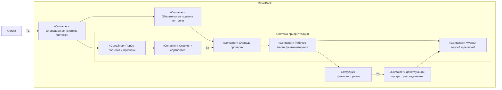
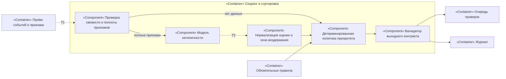
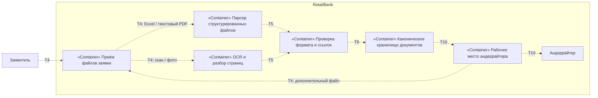
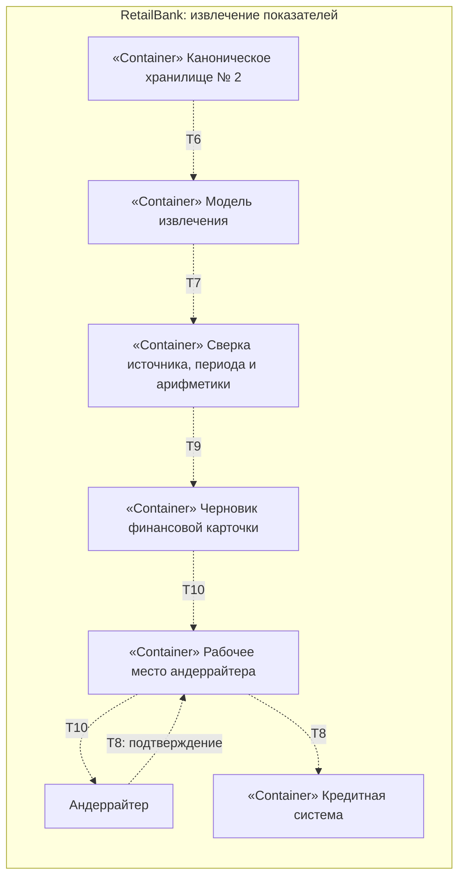

# Задание 3. Архитектура ИИ-сервиса

Продолжение [ADR-001](../Task2/ADR-001-operation-prioritization.md) и паспортов [№ 1](../Task2/passport-01-operation-prioritization.md), [№ 2](../Task2/passport-02-document-digitization.md), [№ 18](../Task2/passport-18-financial-extraction.md). На схемах `«Container»` и `«Component»` обозначают уровни C4; пунктирные переходы `T1`–`T10` — пронумерованные границы доверия.

## № 1. Приоритизация операций: C4 Container

## № 1. Скоринг и сортировка: C4 Component

Сервис работает **асинхронно**: события обновляют признаки, скоринг рассчитывает кандидатов, сортировка периодически формирует очередь. Платёж не ждёт модель. Повтор по ключу `operation_id + window_end + model_version + feature_version` не создаёт второе дело; новые версии дают отдельный результат. При сбое действует прежний маршрут правил, а сотрудник продолжает работу через существующий процесс. В теневом пилоте скоринг не меняет рабочую очередь.

Калибровки в вероятность схемы пока нет: подтверждённых меток недостаточно. Нормализация даёт сопоставимый **приоритет**, а порог/зона воздержания отделяют случаи для ручного разбора. Назначение платежа — недоверенное поле данных; RAG, промпты, агентские инструменты и дообучение здесь не нужны.

### Ответственность и автоматизация

| Исполнитель | Ответственность | Уровень автоматизации |
| --- | --- | --- |
| Код приёма и признаков | Временные окна, связи платежей, свежесть данных, идемпотентность | Выполняет сам |
| Модель | Оценка нетипичности на доступных признаках | Только рекомендует приоритет |
| Код политики и валидатор | Обязательные правила, резерв их очереди, сортировка, лимит мощности, проверка ответа | Выполняет сам; не принимает решение по клиенту |
| Очередь и рабочее место | Назначение, срок, исходник и причины для сотрудника | Передают на проверку |
| Сотрудник финмониторинга | Проверка, расследование, решение и причина действия | Личное подтверждение по установленной процедуре |

### Выходной контракт флагмана

| Поле | Требование и проверка до постановки в очередь |
| --- | --- |
| `operation_id`, `client_ref`, `window_end` | Обязательны; операция и окно существуют, идентификаторы не смешаны |
| `feature_as_of`, `feature_version`, `model_version` | Обязательны; признаки не позже решения и в согласованном сроке свежести |
| `score`, `score_kind` | Число конечное в согласованной шкале `[0,1]`; `score_kind=anomaly_rank`, это не вероятность нарушения |
| `source_refs`, `reason_codes` | Ссылки на операции/временное окно и проверяемые причины; неизвестные коды отклоняются |
| `abstain_reason` | Если признаки отсутствуют, устарели или случай вне области модели: `score=null`, причина обязательна; нуль не означает отсутствие данных |
| `rule_flags`, `priority` | Флаги приходят от отдельного движка правил; политика резервирует обязательные случаи, `priority` не даёт права на блокировку |

Валидатор проверяет схему, идентификаторы, свежесть, источник и политику **до** публикации в очереди. При нарушении запись идёт по действующим правилам с указанием причины. Лимит ручной работы — подтверждённая мощность около 10 тыс. проверок в месяц **за вычетом** обязательного резерва; точный `K` устанавливает владелец процесса.

### Фолбэк и мониторинг флагмана

| Наблюдаемый признак | Маршрут |
| --- | --- |
| Нет/устарели признаки, новый клиент без истории, неизвестный сегмент | `score=null`; действующие правила и ручная проверка по их приоритету |
| Оценка близка к порогу или расходится с обязательным правилом | Воздержание; обязательное правило имеет приоритет, сотрудник видит расхождение |
| Модель/сервис признаков недоступны, превышен лимит | Ограниченный режим: текущие правила и очередь; повтор позже без дубля дела |

| Слой | Сигнал | Повторная проверка или откат |
| --- | --- | --- |
| Вход | Доля пустых/устаревших признаков, новые сегменты и изменение распределений | Проверить источник и качество на новом сегменте при выходе за согласованный контрольный диапазон |
| Модель | Доля воздержаний, нарушения контракта, сдвиг оценок по сегментам | Регрессионный прогон; при нарушении контракта отключить скоринг для затронутого сегмента |
| Ручная очередь | Обязательные случаи, число и возраст дел, исправления сотрудниками | Ноль потерянных обязательных случаев; при превышении подтверждённой мощности вернуть прежний приоритет |
| Бизнес | Полезные находки на 1000 проверок при той же мощности; ошибочные приостановки и жалобы | Сравнить с baseline по независимой контрольной выборке; при ухудшении вернуть прежнюю очередь |

После выхода в новый сегмент эти сигналы проверяются **по сегментам**: доля новых клиентов, профиль операций, полнота признаков, оценки/воздержания, состав top-K и независимые полезные находки. Изменение модели или нормировки проходит регрессию на старых и новых клиентах, теневой прогон и ограниченный canary в необязательной части очереди; при нарушении guardrails применяется прежняя версия/очередь правил. План диагностики — [задание 5](../Task5/degradation-diagnosis.md).

## № 2. Оцифровка документов: C4 Container

## № 18. Извлечение показателей: C4 Container

Для № 2 и № 18 обработка пакета асинхронная; андеррайтер получает черновик и подтверждает значения до их использования. При недоступности OCR или модели файл остаётся в очереди, повтор идемпотентен по документу и версии обработки; ручной разбор сохраняется. Для № 18 контекстом служат нужные страницы и таблицы из канонического документа, с привязкой к источнику. RAG и агент не нужны: маршрут и набор документов заявки известны; модель не получает инструментов записи в кредитную систему.

## Границы доверия

| № на схеме | Угроза | Что делаем |
| --- | --- | --- |
| T1 | Клиент управляет назначением платежа; текст или значения могут исказить признаки | Считать вход данными, проверять формат/длину, разрешённые поля и время доступности; не исполнять инструкции из текста |
| T2 | Ошибочный ответ или подменённые веса/зависимости влияют на приоритет | Проверять тип, диапазон, версии и источник; фиксировать происхождение весов/зависимостей и регрессионный прогон; модель не пишет в ядро |
| T3 | Действие по ошибочному делу затронет клиента | Проверять роль сотрудника и полномочия в действующем процессе; журналировать подтверждение и причину |
| T4 | Файл заявителя или загруженный андеррайтером файл содержит вредное содержимое; обработчик получает непроверенный документ | Проверять полномочия и привязку к заявке, тип/размер; изолировать файл и парсер/OCR, не выдавать права на хранилище до валидации |
| T5 | Парсер или OCR выдаёт неверные поля, структуру или недоверенный текст | Валидировать структуру и ссылки на страницу; считать результат данными, а не инструкцией для последующей модели |
| T6 | Канонический документ из хранилища № 2 содержит инструкции в тексте или раскрывается при извлечении | Читать только валидированную версию и нужные фрагменты по правам сервиса в согласованном контуре; не выполнять инструкции из документа, запретить непроверенный внешний вызов и избыточные логи |
| T7 | Модель выдумывает показатель или формирует вредный вывод | Проверять схему, источник, период, валюту и расчёты кодом; нет источника — пустое поле и человек |
| T8 | Неверное значение попадает в кредитный процесс | Запись только после подтверждения андеррайтера; отдельные права чтения и записи, аудит; инструментов записи у модели нет |
| T9 | Непроверенный документ или показатель записывается как канонический/подтверждённый | Разрешать запись только валидатору, проверять статус и привязку к заявке и первоисточнику; хранить версию и журнал исправлений; черновик № 18 не становится подтверждённым автоматически |
| T10 | Документ или финансовый черновик раскрывается неуполномоченному пользователю рабочего места либо при показе андеррайтеру | Проверять роль и доступ к конкретной заявке при каждом чтении и показе, ограничивать выдаваемые поля и журналировать доступ |

Сервисные учётные записи получают минимальные права на свои данные. Версии модели, OCR, справочников и библиотек проходят контроль происхождения и проверку перед выкатом. Реальные документы, тексты и результаты не покидают согласованный контур; применимость конкретного режима подтверждают профильные команды, как указано в Task2.
